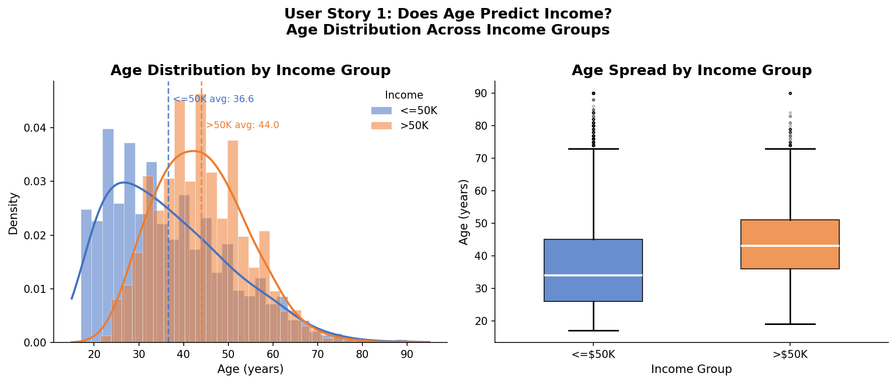
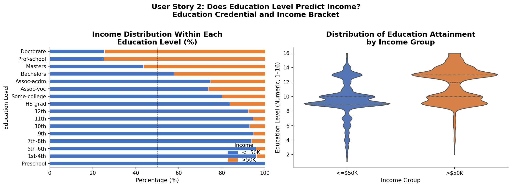
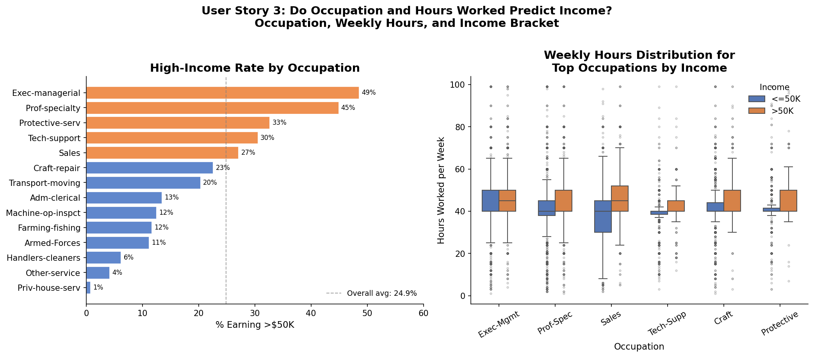
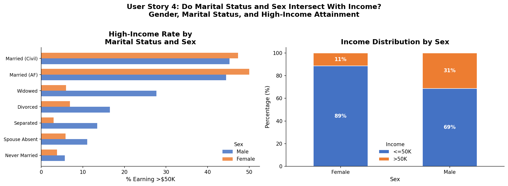
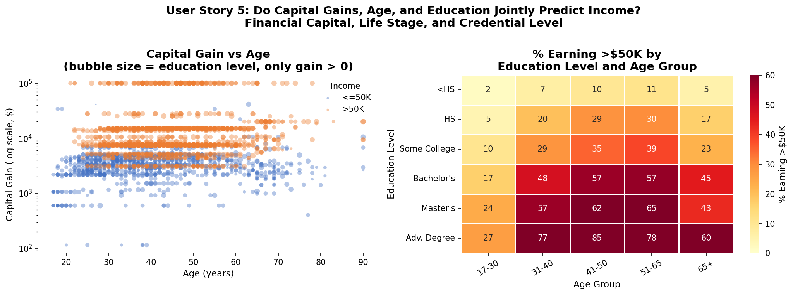
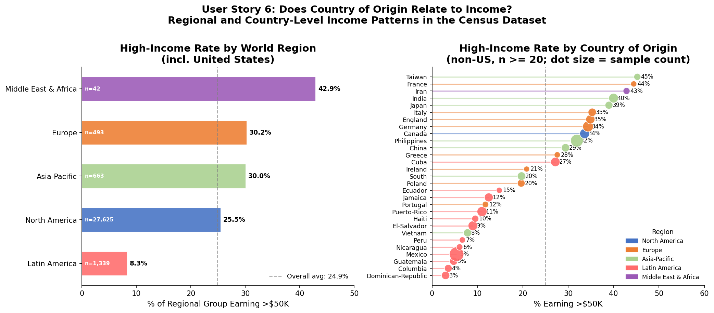
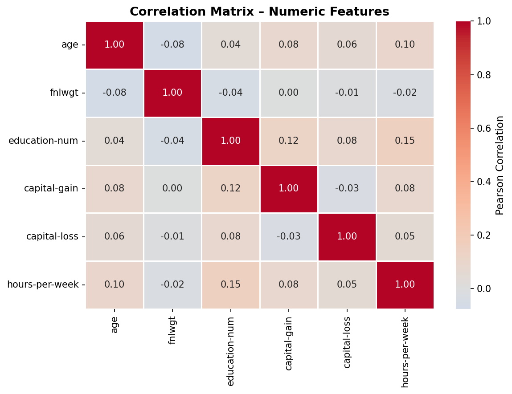

# Census Income Visual Analytics

A user-story-driven exploratory data analysis of the UCI Adult Census Income dataset: five questions about what predicts income, answered with seven publication-style visualizations built in Python (pandas, seaborn, matplotlib).

## Overview

Good visualization starts with a question, not a chart type. This project frames the analysis as five user stories — *does age predict income? does education? do occupation and hours worked? do marital status and sex intersect with income? do capital gains, age, and education jointly predict it?* — and answers each with a purpose-built, two-panel figure: overlapping distributions with KDE overlays, stacked percentage bars, dot plots, grouped boxplots, violin plots, log-scale bubble scatter, and an annotated heatmap. The result is a complete analytics narrative, from question to visual evidence.

## The Five User Stories

| # | Question | Visualization |
|---|---|---|
| 1 | Does age predict income? | Overlapping histograms + KDE, grouped boxplot |
| 2 | Does education level predict income? | Stacked % bars by credential, violin plot of education-years |
| 3 | Do occupation and hours worked predict income? | High-income rate dot plot by occupation, hours boxplots for top 6 occupations |
| 4 | Do marital status and sex intersect with income? | Grouped bars by marital status × sex, stacked income distribution by sex |
| 5 | Do capital gains, age, and education jointly predict income? | Log-scale bubble scatter (age × capital gain, sized by education), education × age heatmap |

Plus two supporting figures: a **correlation heatmap** and a **country/region income** view.

## Visualizations

**1 — Age distribution by income group**


**2 — Education level vs income**


**3 — Occupation and hours worked vs income**


**4 — Marital status and sex vs income**


**5 — Capital gain, age, and education vs income**


**Supporting — country/region and correlation**



## Key Findings (read with the data note below)

- **Age:** the >50K group skews older (mean ~44 vs ~37) — income rises with life stage, but the overlap is large; age alone is a weak predictor.
- **Education:** the share earning >50K climbs steeply with credentials — from single digits at lower levels to a majority at Masters/Doctorate.
- **Occupation:** executive, professional-specialty, and tech roles have the highest >50K rates; service and labor occupations the lowest.
- **Marital status × sex:** married (civil) men show the highest >50K rates by a wide margin — the classic census-data interaction.
- **Capital:** most records have zero capital gain; among those with gains, higher education and prime-age workers dominate the >50K group.

## A Note on the Data — Please Read

The analysis was performed on the **UCI Adult Census Income** dataset (30,162 records, income split ≤50K / >50K). This repo does not ship the original respondent records. The runnable script `census_eda.py` **reconstructs a dataset from the original analysis's summary statistics** — group means, crosstab counts, and distributions — with a fixed random seed (42), so every figure regenerates exactly without downloading the data.

What that means honestly: the visualizations faithfully reproduce the *patterns and summary statistics* of the analysis, but the individual rows are synthetic. Don't cite exact counts from regenerated charts as census facts; cite the patterns. The two supporting figures (`viz6`, `correlation_heatmap`) are pre-rendered from the original notebook analysis.

## Technologies

- **Python** — pandas, NumPy, SciPy
- **seaborn / matplotlib** — statistical visualization
- **Jupyter** — original exploratory analysis

## Reproducing the Charts

```bash
pip install pandas numpy matplotlib seaborn scipy
python census_eda.py   # writes PNGs into ./charts/
```

Deterministic: `np.random.seed(42)` — same figures every run.

## Repository Structure

```
census-income-visual-analytics/
├── census_eda.py   # Reproducible visualization script (5 figures)
├── charts/         # Pre-rendered figures (7 PNGs)
├── requirements.txt
├── LICENSE
└── README.md
```

## Validation

- Crosstab counts in the reconstruction match the notebook's published counts exactly (e.g. marital-status and race tables are built from exact per-cell counts, not approximations).
- Fixed seed makes every run byte-identical — re-running the script overwrites the charts with the same figures.

## Future Improvements

- Ship the script against the real UCI dataset behind a `--real-data` flag (download from UCI ML Repository) and diff the figures.
- Add statistical tests (chi-square, ANOVA) alongside the visuals.
- Interactive versions of the heatmap and scatter with Plotly.

## Academic Context

This project was completed as part of graduate coursework in **CSE 578: Data Visualization** at Arizona State University. It is presented here as academic project experience: a learning exercise in visual analytics and honest data communication.
